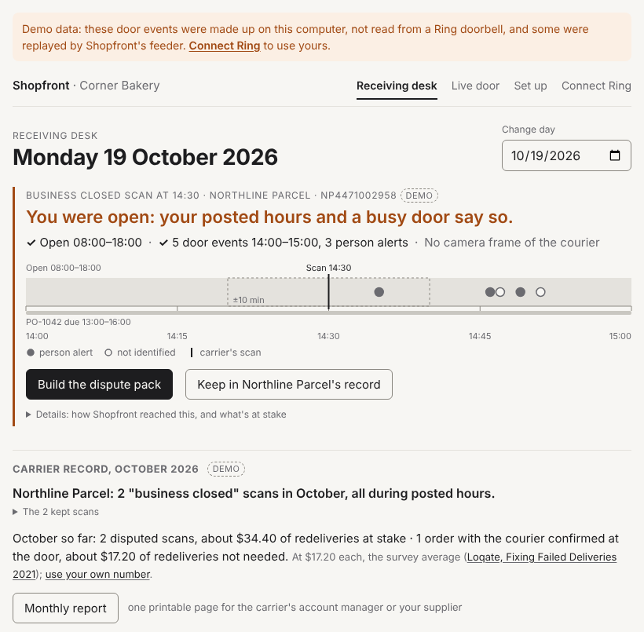

# Shopfront
**The carrier scanned "business closed". Your doorbell says you were open.**



```bash
python3 -m venv .venv && .venv/bin/pip install -r requirements.txt
cp .env.example .env
.venv/bin/python -m scripts.demo
```

Run it from a clone of this repo with Python 3.11+. It starts Shopfront at http://127.0.0.1:8000 and
prints three links: the check above, the receiving desk and the dispute pack. The demo shop, its carrier
and its door events are made up (synthetic events plus one signed webhook replay), and every page says so.

Shopfront is a receiving desk for a one-door shop (a bakery, café or boutique) with a Ring doorbell. It
checks a carrier's "business closed" or "delivery attempted" scan against the shop's posted hours and what
the doorbell recorded, and builds a dispute pack the owner reviews and sends themselves.

**What's live:** Shopfront calls the Ring Partner API live against the Ring Developer Playground. A Ring
frame, a webhook sent by Ring itself and a Bedrock label haven't been captured yet.
[Status and proof](docs/status.md).

## What only Shopfront does

A doorbell clip shows who came to the door. On its own it's evidence of a visit, not an answer to the
carrier's scan. Shopfront goes four steps further:

1. **It keeps a record per carrier, month by month.** The desk shows, per carrier, how many "business
   closed" scans it made this month and how many fell in posted hours. `/report` prints that record on one
   page for the carrier's account manager or the supplier.
2. **It ties the scan to the order.** From the shop's own CSV (by tracking number, or from the order's row
   on the desk), so the pack names the order, supplier, items and delivery window, not just a time.
3. **It checks the scan against the hours and the door.** Posted hours, and door activity 30 minutes either
   side. When the door recorded nothing it says so: only the hours back you, or it can't tell.
4. **It makes a signed pack anyone can check offline, addressed to the supplier**, the carrier's customer,
   who can get a scan corrected. The zip's manifest is signed (Ed25519 or an AWS KMS key), and
   `scripts/verify_pack.py` checks it with no account and no network.

## How many shops this could help: an estimate (US)

| Factor | Value | Source |
|---|---|---|
| Retail shops with fewer than 20 employees | 877,627 | US Census Bureau, [County Business Patterns 2023](https://www2.census.gov/programs-surveys/cbp/datasets/2023/cbp23us.zip), NAICS 44-45, size classes under 5, 5-9 and 10-19: 457,825 + 248,198 + 171,604 |
| Parcel deliveries to a shop in a week | 5 | **Assumption.** We found no survey of how many parcels small shops receive |
| First deliveries that fail | 8% | Loqate, [*Fixing Failed Deliveries* 2021](https://info.loqate.com/hubfs/Loqate%202021/Fixing%20Failed%20Deliveries/Fixing%20Failed%20Deliveries%20-%20Final.pdf), US: "8% of first-time deliveries fail" (retailers' parcels to customers, a stand-in for deliveries to shops) |
| What a failed delivery costs the sender | $17.20 | The same report: "at an average cost of $17.20" |

877,627 shops × 5 × 52 weeks = 228.2 million deliveries a year; 8% is 18.3 million failed first attempts,
and at $17.20 each about **$314 million a year** in senders' costs. Per shop: about 21 failed deliveries
($358) a year, before any lost trade.

We found no source for what share of those are wrong "business closed" scans, or how many of these shops
have a Ring doorbell, so $314 million is the pool the check works on, not Shopfront's market. Cafés and
restaurants (NAICS 722, another 495,905 places in the same file) aren't counted.

**The nearest count we found.** USPS's Office of Inspector General audits single delivery units. At three
Houston-area units it picked, employees scanned 2,224 packages at the post office instead of at the address
from May to July 2023, 175 of them "Delivery Attempted – No Access". The same audit counted 29 "Business
Closed" scans made more than 1,000 feet from the delivery point
([report 23-151-R24, January 2024](https://www.uspsoig.gov/sites/default/files/reports/2024-01/23-151-r24.pdf),
tables 5 and 6). That's a count at audited units, not a rate, so it isn't in the arithmetic.

**What owners say:** "they sent me a note that they had tried to deliver, which was impossible because we
were here and the store was open and no one came" (Hank Kornblut, Mister Brisket, Cleveland:
[News 5 Cleveland, 17 Dec 2024](https://www.news5cleveland.com/news/local-news/customers-express-frustration-over-fedex-delivery-delays-as-holidays-approach)) ·
"UPS keeps claiming my bookstore is closed on Mondays when it's not … I'm losing sales by not having
inventory when I need it" ([r/UPS, Nov 2025](https://www.reddit.com/r/UPS/comments/1ouc0b4/)) ·
"Driver turned around in my parking lot, looked at me through an open overhead door, then drove away and
marked my stop as undeliverable because 'the business was closed.'" (the poster had security footage:
[r/UPS, May 2023](https://www.reddit.com/r/UPS/comments/1382n67/)).

## Why

- **It costs the sale.** In November 2024 a boutique in Clear Lake, Texas, waited on six boxes of denim
  for its Black Friday sale while UPS tracking read "Business closed. Will deliver the next business day,"
  and the store was open
  ([KPRC Click2Houston, 28 Nov 2024](https://www.click2houston.com/news/local/2024/11/29/small-business-scrambles-after-ups-mix-up-threatens-black-friday-plans/)).
- **The scan code itself has been disputed.** In 2015 UPS agreed to pay $25 million to settle a False
  Claims Act case alleging it applied inapplicable exception codes such as "business closed" to excuse
  late deliveries to federal customers. Allegations only: UPS made no admission and there was no finding
  of liability ([US Department of Justice, 19 May 2015](https://www.justice.gov/opa/pr/united-parcel-service-agrees-settle-alleged-civil-false-claims-act-violations)).
- **Ring's Package Alerts answer a different question:** a box landed in your Package Zone. Ring says
  they "work best with medium-to-large shipping boxes" and need a compatible subscription
  ([Ring support](https://ring.com/support/articles/rk2nf/How-to-Get-Package-Alerts)). That doesn't help
  when nothing was delivered. Shopfront checks the carrier's claim instead, with no package in view.

## How Ring and AWS do the work

1. **Orders in.** A CSV of orders or invoices from any POS, inventory or accounting export.
2. **Ring sees the door.** The Ring Partner API's Event History gives every ding and motion. A signed Ring
   webhook whose motion `sub_type` is `package_delivery` (Ring's Smart Alert) marks a courier with no model
   call. Other visits go to **Amazon Bedrock**, which labels the Ring frame (courier, customer, staff).
   Without a frame, time-of-day rules guess, and the page says so.
3. **Check the scan** against the posted hours and every door event within 30 minutes.
4. **Dispute pack:** the finding, door log, posted hours, order, the request IDs of the Ring and Bedrock
   calls it rests on, what it can't show, and a draft. Shopfront never sends anything.

## Run the demo

The three commands at the top. `--port` picks another port; data lives in `.data/demo` (git-ignored) and
starts fresh each run. What each link shows, the hosted read-only demo (template ready, not deployed),
tests, using Shopfront from a phone, and connecting a real Ring doorbell: [docs/run.md](docs/run.md).

## At home too

The "delivery attempted" check doesn't use opening hours: it compares the carrier's time with what the
doorbell recorded within 10 minutes, so it works at a house too. With no order linked, the draft goes to
the carrier. There's no separate home mode; the pages still say "shop".
[docs/receiving-desk.md](docs/receiving-desk.md#at-home-the-delivery-attempted-check).

## Also in the app

- **Ask Shopfront** (`POST /api/ask`): a [Strands](https://strandsagents.com) agent on Amazon Bedrock with
  five tools over the same data. Every answer lists its tool calls and Bedrock RequestIds. Needs AWS
  credentials with Bedrock access.
- **Morning briefing:** doorbell presses while closed, staff first and last at the door, and foot traffic
  against the same weekday last week.
- **Staff tap:** once Ring or Bedrock has seen the courier, staff mark an order All there, Short or
  Damaged; short or damaged gets its own dispute pack.

## Limits

- Ring has no "door answered" signal. Shopfront can say a courier was at the door, not that a parcel was
  handed over.
- A pack supports the owner's account but can't prove nobody came: motion detection can miss people.
  Every pack says so.
- Time-of-day rule labels are guesses. Only Ring's `package_delivery` alert or a Bedrock-labelled frame
  counts as a courier.
- Ring only returns events from after the owner connected, so "vs last week" is empty for the first week.
- One shop, one doorbell. One-way Ring account linking is built to the API reference
  ([docs/ring.md](docs/ring.md), section 10) but hasn't been run against a real Ring AppStore install or
  certified.

## License

MIT
